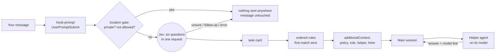

# Model router

*Last updated: 2026-10-17*

## What it does

The router has Jev (TypeSafe) draw up a small **task card** for every message sent to Claude Code, then applies an ordered list of **rules** to decide which helper agent should do the job: a cheaper model for small jobs, a more capable one for risky jobs, a read-only analyst for open questions. It is **off by default**, and `ecotokens router on` / `off` turn it on and off.

Claude Code cannot switch the main session's model for each message, and a hook cannot change it either. The closest thing that works is a `UserPromptSubmit` hook that tells the main session which helper agent should do the job. The routing is **advisory**: the main session may handle a message itself when delegating makes no sense.



### The task card

One request carries six questions, answered in parallel, so routing still costs one round trip.

| Field | Values | Meaning |
| --- | --- | --- |
| `size` | `tiny`, `everyday`, `large`, `hardest` | the smallest model tier that can do the job well |
| `needs_conversation` | probability | a follow-up that only makes sense in the conversation |
| `nature` | `mechanical`, `implementation`, `bug`, `design`, `ui`, `research`, `sensitive` | the kind of work |
| `risk` | `reversible`, `sensitive`, `destructive` | the harm a wrong result could do |
| `ambiguity` | probability | decisions are missing (high from `router_ambiguity_min_prob`, default 0.5) |
| `verifiability` | probability | the result can be checked by tests, a build, a browser or a state (from `router_verifiable_min_prob`, default 0.5) |

A choice answer carries a confidence. When an answer is below `router_card_min_confidence` (default: `router_min_confidence`, 0.6) it is *unreliable*, and the card falls back in this order:

1. `size` unreliable: the main session keeps the message.
2. `size` fine, `risk` unreliable: the size-only route, **raised by one tier** (never above `hardest`).
3. `size` and `risk` fine, `nature` unreliable: the rules that need the nature do not match; the rest still apply.

The number of files a job touches is never an input.

| Tier | Jev criterion | Agent | `model:` |
| --- | --- | --- | --- |
| tiny | a quick lookup, a rename, a factual question or a one-line answer | `router-tiny` | haiku |
| everyday | a normal email, a social post, a short document, a simple explanation or a small self-contained code change | `router-everyday` | sonnet |
| large | a multi-step build, research, a full report, or code changes across several files | `router-large` | opus |
| hardest | strategy, architecture, high-stakes decisions, or anything where a wrong call is expensive | `router-hardest` | fable |
| analyst | read-only analysis: constraints, options, trade-offs, sourced research | `router-analyst` | opus |
| reviewer | read-only review of a result from the diff and test output | `router-reviewer` | opus |

Rules name tiers, not models: a model upgrade changes one table, not the rules.

### Default rules (policy `2026.1`)

Rules are evaluated top to bottom; the first match wins. `ecotokens router rules` prints them.

| # | Rule | When | Route | Extras |
| --- | --- | --- | --- | --- |
| 1 | `sensitive-work` | risk `sensitive` or `destructive` (a `sensitive` nature counts as a sensitive risk) | at least `large` | reviewer required, explicit approval before irreversible actions |
| 2 | `design-options` | nature `design`, ambiguity high | analyst | constraints, options, trade-offs, acceptance criteria; no implementation |
| 3 | `research-sources` | nature `research` | analyst | primary sources, dates, claim-to-source |
| 4 | `mechanical` | nature `mechanical`, verifiable, size `tiny` or `everyday` | `tiny` | prefer a deterministic tool or script |
| 5 | `ui-browser` | nature `ui` | by size | verify rendering in a browser when one is available |
| 6 | `bounded-bug` | nature `bug` | by size, at least `everyday` | reproduce first, add a regression test |
| 7 | `spec-feature` | nature `implementation`, ambiguity low | by size | none |
| 8 | `size-only` | anything | by size | exactly the router before the task card |

With no custom rules and no sensitive, design or research trait, the route is the size-only route.

### Custom rules

One optional file, `~/.config/ecotokens/router_rules.toml`, adds rules that are evaluated **before** the defaults:

```toml
[[rule]]
name   = "payments-need-review"   # 1-48 chars of a-z, 0-9 and -; unique
route  = "large"                  # tiny | everyday | large | hardest | size | analyst
review = "required"               # none | suggested | required
approval = "irreversible"         # none | irreversible
hints  = ["Check idempotency of every payment call"]   # up to 3, 160 chars each

[rule.when]                       # all keys must hold; a list means "any of"
nature = ["implementation", "bug"]
risk   = ["sensitive"]
```

Other keys: `bound = "at-least"` (the tier is the higher of the size and `route`, so a rule can raise a job but never lower it), `when.size`, `when.ambiguity` (`high` or `low`), `when.verifiable` (`yes` or `no`). Each rule is checked on its own: an invalid rule (unknown key or value, duplicate name, an analyst with a review, `review = "required"` without a sensitive or destructive risk) is dropped with a warning and listed with `valid: false` by `ecotokens router rules --json`. A file that is not valid TOML is ignored with one warning. At most 100 rules are read.

The **policy version** is `2026.1` for the shipped rules and `2026.1+u<8 hex>` with a custom file (FNV-1a of the file's bytes), recorded on every decision so the figures stay comparable.

## Privacy: private locations and strict mode

"Private" means **not sent to Jev**. It does not stop the main Claude Code session from reading the folder or sending it to Anthropic as usual.

```bash
ecotokens router private add            # the current folder (or a PATH, or a glob like ~/clients/*)
ecotokens router private check [PATH]   # private or not, and why
ecotokens router allow add [PATH]       # allow list, used only in strict mode
ecotokens router strict on              # route only the allowed locations
```

The gate runs **first** in the hook, before the judge, the statistics or the network. For a private folder nothing is sent, nothing is injected, and the database keeps only a timestamp and the kind (`private`). Matching:

- a listed folder and everything below it; whole path segments only (`clients/*` covers `clients/acme`, not `clients-old`);
- symbolic links are resolved, and another worktree of a listed repository is covered (read from `.git`, no `git` subprocess);
- an unresolvable working directory, or a settings file that cannot be read, counts as private (fail closed);
- private wins over allowed; an allowed folder is routed only when strict mode is on.

Entries of a folder that no longer exists are kept and shown as `missing`; an invalid pattern is shown as `invalid` and ignored. The lists live in your user settings, never in a project: nothing is written inside a project directory.

## Stopping a loop: the dossier

Every helper agent file carries the standing rules: stop after `router_max_attempts` attempts (default 2) without a new, testable hypothesis; a failure of the environment (network, rate limit, missing tool) is not a reasoning failure; ask for clarification when the acceptance criteria contradict each other; never raise tools or permissions after a failure.

When a helper stops it runs `ecotokens router dossier` with a JSON object on its standard input (`goal`, `constraints`, `commands`, `errors`, `discarded`). The command adds the **real** `git diff HEAD` itself (bounded, never the previous agent's account), masks everything, and writes a handoff file under `~/.config/ecotokens/handoff/` that `/handoff-load` can read. A dossier is stored as already consumed, so a later SessionStart never injects it; the usual handoff retention removes it.

The read-only analyst and reviewer cannot run commands; they end their reply with the dossier content and ask the main session to run the command.

## Review and approval

A rule with `review = "required"` makes the guidance ask the main session to call `router-reviewer` after the producer returns, with the goal, the constraints, the `git diff` and the test output (not the producer's summary), and to show the verdict unchanged. A rejection does not start an automatic second production round. `approval = "irreversible"` asks for explicit user approval before any irreversible action. `review = "suggested"` makes the review optional. Rules with neither add neither.

The analyst and the reviewer are read-only because their agent files declare an explicit `tools` allowlist (`Read`, `Grep`, `Glob`, the ecotokens read tools, and `WebSearch` / `WebFetch` for the analyst only), not because their instructions ask politely.

## Outcomes: which routes work

`ecotokens router status` groups delegated jobs by route, category (nature) and policy version. Cost, tokens, helper time and the number of helper runs (retries and reviews included) are measured automatically at `SessionEnd` from the session transcript. Whether a job worked is judged in two ways:

- **By the reviewer, automatically.** `router-reviewer` starts its reply with `Verdict: approve` or `Verdict: reject`. At `SessionEnd` the router reads that line and records it as the job's success, marked as coming from the reviewer. A rejection is a failure. An approval counts as a success only when exactly one helper produced the result (a retry or a second producer leaves the job unjudged), because `success = yes` means "verified success on the first attempt". A reply without a readable verdict, or a job without a review, stays unjudged. Agent files installed before this change need `ecotokens router on` to pick up the verdict line.
- **By you, manually.** Your judgment always wins: it replaces a reviewer verdict, and the reviewer never overwrites yours.

```bash
ecotokens router outcome --pending                       # jobs awaiting a judgment
ecotokens router outcome 12 --success yes --correction minor --regressions 0
```

`ecotokens router status` shows how many verdicts came from the reviewer (`by rev.`) and the success rate of your own judgments only (`manual`). The reviewer is a model and can approve a wrong result, so the combined `success` rate may be optimistic. Judge a sample by hand and compare the `manual` rate with the combined one before relying on the reviewer's verdicts. The outcomes never change the routing itself.

A job nobody judged is *unknown* and is left out of success rates. The next `SessionStart` prints one line (`2 delegated jobs have no judgment yet`) once per job; nothing is printed for private or not-allowed folders. The transcript of a private folder is never opened.

### Tokens and cost per tier

`ecotokens router status` shows, per route, the average input and output tokens of a job (`avg in→out`, e.g. `20.5k→1.0k`) and a `usage (totals)` table with the total input tokens, output tokens and cost of each route, plus a `total` line over all routes:

```text
usage (totals)      measured  tokens in tokens out        cost
router-everyday          1/1       2.5k        500           -
router-large             2/2      41.0k       2.0k     $0.3000
router-tiny              0/1          -          -           -
total                    3/4      43.5k       2.5k    $0.3000*
```

- **Measured, not estimated.** Token counts are read from the session transcript at `SessionEnd` (input includes cache creation and cache reads; retries and reviews are included). A run that reports only a total is counted as input and gives no output figure.
- **Unmeasured jobs never count as zero.** `measured 3/4` means 3 of the 4 delegated jobs were measured; totals and averages cover only those. A route with no measured job shows `-`.
- **Cost = measured tokens × the price you configured.** ecotokens has no built-in price list, so the cost is only as good as the price you entered (an estimate when you enter list prices yourself). A job's cost is blank when one of its runs has no price at all (neither input nor output) or no input/output split; a price with only one part set (say no output price anywhere) counts the missing part as $0 and the cost is still shown. `*` marks a total that covers fewer jobs than were measured (`priced` in `--json`).
- **No savings figure.** Nothing is compared with what a bigger model would have cost: these are the costs of the helpers only.

Prices are per million tokens, in USD. Each helper run is priced at the price of its tier (`router-analyst` and `router-reviewer` run on the `large` tier); each part (input, output) that a tier leaves unset falls back to the global price of `ecotokens gain price`. Tier prices are unset by default: set the ones you want yourself.

```bash
ecotokens router price --tier large --input 15 --output 75   # set the large tier
ecotokens router price --tier tiny --output 4                # one part only
ecotokens router price --tier tiny                           # show it (with the global fallback)
ecotokens router price --tier large --clear                  # unset it: the global price applies again
```

A cost is computed once, when the job is measured at `SessionEnd`. **Costs already stored are not recomputed** when a price changes: only jobs measured afterwards use the new price, and a job stored without a cost stays without one. Run `ecotokens router reset` to start the figures over after changing the prices.

`router status --json` gives the same figures with stable names. Each entry of `by_route` and `by_category`, and the new `totals` object (all delegated jobs), carries `delegated`, `measured`, `priced`, `tokens_in`, `tokens_out`, `cost_usd` (totals, `null` when nothing was measured or priced), `avg_tokens_in` and `avg_tokens_out`, next to the existing keys (`avg_tokens` keeps the combined average). A `prices` object lists the global price and, per tier, the price applied with the source of each part (`tier`, `global` or `unset`).

### Starting over: `router reset`

```bash
ecotokens router reset --backup          # asks, then copies router.db and clears the routing data
ecotokens router reset --yes --json      # scripts: no question, {"decisions", "outcomes", "backup"}
```

`router reset` deletes every row of `router_outcomes`, then of `router_decisions`, in one transaction, and prints how many of each it deleted. Use it after changing the rules or the thresholds, so that `router status` only shows figures of the new setup. It keeps:

- the Jev call log (`jev_calls`, read by `ecotokens jev`), which shares the same `router.db` file;
- the settings, the private and allowed locations, `router_rules.toml`, the helper agents and the dossiers.

Safety:

- Without `--yes` it asks for confirmation on the terminal. When standard input is not a terminal (a pipe, a script, a hook), it refuses and deletes nothing; pass `--yes` there.
- `--backup` first writes a copy to `router.db.bak-<UTC timestamp>` next to the database, with SQLite's `VACUUM INTO`, which reads one consistent snapshot of the database and its WAL even while a hook is writing. An existing file is never overwritten. Restore it by copying it over `router.db` while no Claude Code session is running.
- An empty or missing database is reported as 0 deleted, without a question; a missing database is not created.
- Deleted rows are overwritten (`secure_delete`) and the WAL is checkpointed, so they do not linger in the file.
- Job ids are not reused: the `AUTOINCREMENT` sequence of `router_decisions` is kept, so an id seen before the reset (in `outcome --pending`, a dossier or a session still running) never names a new job. A session that started before the reset and ends after it finds no decision of its own and records nothing.

## What it cannot do

- The routing is advisory: the main model still reads every message and does the handoff, so it saves on the work itself, not on the whole turn.
- A helper starts cold, without the conversation. The injected instruction asks the main session to pass along the context the helper needs.
- The `large → opus` size saves nothing when the main session also runs Opus. It only moves the work into its own agent context.
- The hook runs before the message is sent, so Jev's latency adds to every message. See the next section.
- Cost matching is heuristic: a helper run is attached to the job whose time window contains it, and the transcript format is internal to Claude Code. When a run cannot be matched or read, the figure stays unknown, never zero.

## Latency

Measured on 2026-09-23 against `api.typesafe.ai`, most calls took 1.9 to 2.8 s from the server, which is well above the ~100 ms described elsewhere. A few took about 0.45 s, and one returned HTTP 520 after 5 s. With the default `router_timeout_ms` of 800 ms, most messages time out. The first timeout pauses Jev for 5 minutes, so the router mostly stays out of the way and does not route. To actually route, accept the delay:

```bash
ecotokens router on --timeout-ms 3000
```

Claude Code's own hook timeout is set to `ceil(router_timeout_ms / 1000) + 1` seconds as a hard stop. The location gate is local and costs a few milliseconds.

## Live check (2026-09-23, `router try --timeout-ms 15000`)

Size and follow-up figures of the size-only router; the task-card questions were added afterwards (see `docs/BENCHMARKS.md` for the cost of the extra questions).

| Message | Size | Confidence | Follow-up | Decision |
| --- | --- | --- | --- | --- |
| what's the capital of Australia? | tiny | 1.00 | 0.01 | delegated |
| rename the variable usr to user in this line: … | tiny | 0.99 | 0.06 | delegated |
| write a short email declining a meeting on Thursday | everyday | 0.95 | 0.04 | delegated |
| draft a LinkedIn post announcing our v0.26 release | everyday | 1.00 | 0.05 | delegated |
| build a CLI tool that syncs two folders, with tests and a README | large | 0.99 | 0.03 | delegated |
| research SQLite WAL tuning and write a full report with benchmarks | large | 1.00 | 0.03 | delegated |
| should we pivot ecotokens to a paid SaaS? weigh the risks … | hardest | 0.90 | 0.08 | delegated |
| design a zero-downtime migration strategy for our production Postgres database | hardest | 0.99 | 0.02 | delegated |
| yes do that but make it shorter | everyday | 0.37 | 0.95 | self_followup |
| ok go with the second one | tiny | 0.93 | 0.98 | self_followup |

Each request used about 555 input and 66 output tokens (two questions).

## Commands and settings

| Command | Effect |
| --- | --- |
| `ecotokens router on [--timeout-ms N]` | sets `router_enabled`, installs the `UserPromptSubmit`, `SessionStart` and `SessionEnd` hooks in `~/.claude/settings.json`, writes the six agents to `~/.claude/agents/` |
| `ecotokens router off` | clears the flag, removes the hook entries and the agents ecotokens wrote |
| `ecotokens router status [--json]` | per-size, per-decision, per-route, per-category and per-policy figures, outcomes, measured helper tokens (input and output) and cost per route with a total line, location counts, Jev requests, tokens, average latency, cost |
| `ecotokens router try MSG… [--json] [--timeout-ms N]` | draws the card and applies the rules live without recording, even while the router is off; honors private and strict locations |
| `ecotokens router rules [--json]` | the rules in evaluation order, their source and any invalid rule |
| `ecotokens router private add\|remove\|list\|check` | private locations (`--json` on each) |
| `ecotokens router allow add\|remove\|list` | strict-mode allow list |
| `ecotokens router strict on\|off\|status` | strict mode |
| `ecotokens router outcome [ID] [--pending] [--success yes\|no] [--correction none\|minor\|major] [--regressions N]` | judge a delegated job, or list the ones awaiting a judgment |
| `ecotokens router reset [--yes] [--backup] [--json]` | delete the routing decisions and their outcomes from `router.db`, after a confirmation (refused without `--yes` when stdin is not a terminal); keeps the Jev call log, settings, locations and rules; `--backup` copies the database to `router.db.bak-<timestamp>` first |
| `ecotokens router dossier [--json]` | write the dossier of a helper that stops (JSON on stdin) |
| `ecotokens router price --input X --output Y` | Jev price in USD per million tokens. TypeSafe publishes none, so cost stays blank until you set one. Separate from `ecotokens gain price` |
| `ecotokens router price --tier tiny\|everyday\|large\|hardest [--input X] [--output Y] [--clear]` | helper price of one tier in USD per million tokens (shows it without a value; `--clear` unsets it). Unset parts fall back to the global `gain price`. Applies to jobs measured afterwards; stored costs are not recomputed |

| Setting | Default | Role |
| --- | --- | --- |
| `router_enabled` | `false` | master switch |
| `router_timeout_ms` | `800` | maximum time Jev may add to a message |
| `router_min_confidence` | `0.6` | below this size confidence, the main session keeps the message |
| `router_followup_min_prob` | `0.5` | at or above this, the message is treated as a follow-up and kept |
| `router_card_min_confidence` | = `router_min_confidence` | reliability threshold of the `nature` and `risk` answers |
| `router_ambiguity_min_prob` / `router_verifiable_min_prob` | `0.5` | thresholds of the two probability questions |
| `router_private` / `router_allowed` / `router_strict` | `[]` / `[]` / `false` | locations (managed by the commands above) |
| `router_max_attempts` | `2` | attempts before a helper stops; written into the agent files, so re-run `ecotokens router on` after changing it |
| `price_input_usd_per_mtok` / `_output` | unset | helper cost estimates (`ecotokens gain price`); the fallback of every tier |
| `router_tier_prices.<tier>.input_usd_per_mtok` / `.output_usd_per_mtok` | unset | helper price of one tier (`tiny`, `everyday`, `large`, `hardest`), set with `ecotokens router price --tier`; no default price is built in |
| `jev_usd_per_mtok_input` / `_output` | unset | Jev cost estimate |

The router uses `TYPESAFE_API_KEY`, `jev_url` and `jev_max_input_chars`, but not `jev_enabled`, so turning it on does not turn on the other Jev uses.

## Safety

- Messages are masked (`prepare_state`) and size-capped before they are sent. Decisions are logged in `~/.config/ecotokens/router.db` without the message text, the project or any path. Private and not-allowed messages leave only a timestamp and the kind.
- The hook is fail-open: any error, timeout or unexpected input prints nothing and exits 0, so the message goes through untouched. The one deliberate exception is privacy: an unreadable settings file or an unresolvable folder is treated as private, which still lets the message through, but never to Jev.
- Only agent files containing the `managed by ecotokens router` marker are ever written or removed. A user file with the same name is kept, `router on` warns about it, and a route whose helper is shadowed this way is recorded as `no_route` and not injected.
- Install and uninstall of the hooks are idempotent and keep third-party entries on the same events. `ecotokens uninstall` removes them and the agents too.
- The router never writes a permission or a settings change on a helper's behalf, and nothing is ever written inside a project directory.
- **Privacy:** while the router is on, every message outside a private location is sent (masked) to TypeSafe. Mark sensitive folders private, or turn strict mode on so that only the folders you allow are routed.
