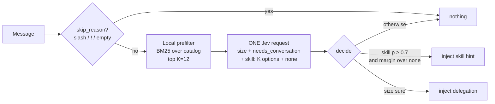

# Skill router: feasibility study

*Status: study only, nothing implemented. Written 2026-10-09.*

## 1. Goal

The [model router](model-router.md) has Jev pick the **model size** for each message. The skill router would have Jev pick **which installed skill fits the message best** (or none), and hint it to the main session before it starts working.

Expected benefits:

- **Fewer wrong or missed skill loads.** Claude Code lists every skill's `description` in the system prompt and lets the model choose. With ~90 enabled skills (this machine), overlaps are common: `docx` / `document-skills:docx` / `anthropic-skills:docs`, `code-review` / `code-reviewer` / `code-review:code-review`. Loading the wrong `SKILL.md` costs several thousand tokens, and missing the right one gives a worse answer.
- **Fewer discovery round-trips** (`find-skills`, `ListSkills`, `ToolSearch`) when the user doesn't name the skill.
- **Measurable routing.** Today nobody knows how often Claude picks the right skill. The router would record its decisions, and transcripts show what Claude actually invoked, so the two can be compared (section 8).

Non-goal: the router does **not** remove skill listings from the system prompt. ecotokens cannot do that from a hook, so the direct token saving per turn is small. The value is in accuracy and fewer wasted loads.

## 2. What already exists and can be reused

| Piece | Where | Reuse |
| --- | --- | --- |
| `UserPromptSubmit` hook, install/uninstall, idempotence | `src/router/hook.rs`, `src/install.rs` | same hook process, same entry |
| Jev client, masking, size cap, circuit breaker, `jev_down` marker | `src/jev/client.rs`, `src/router/hook.rs` | unchanged |
| `Question::choice` + `ChoiceAnswer.probabilities` | `src/jev/mod.rs` | the core primitive |
| Decision recording (`router.db`), Jev usage stats (`Purpose::Router`) | `src/router/stats.rs`, `src/jev/stats.rs` | add a skill column / purpose |
| `router try` for live checks without recording | `src/router/cli.rs` | extend to show the skill pick |
| Transcript reading | `src/handoff/` | offline evaluation (section 8) |

**The key point:** Jev answers every question in one request **in parallel**, and adding questions "barely changes the response time" (TypeSafe Choice docs). Adding a `skill` question to the router's existing request (`size` + `needs_conversation`) costs **no extra round-trip**. Given the 1.9–2.8 s latency measured on 2026-09-23, a second request would not be acceptable.

## 3. Jev constraints (from docs.typesafe.ai, Choice primitive)

- A Choice accepts **up to 255 options**. Each one costs "a few tokens", plus its description.
- The docs recommend a **`none` option** when the list may not cover the input. This is essential here, since most messages need no skill.
- `confidence` is low when probability is spread across several options. That is expected with near-duplicate skills (see 6.3).
- For large taxonomies, the docs suggest chaining Choices level by level (Hierarchical Classification cookbook). Chaining means sequential requests, which is too slow for a hook.

## 4. Skill catalog

### 4.1 Sources (Claude Code first, per harness priority)

1. `~/.claude/skills/*/SKILL.md` (user skills)
2. `<cwd>/.claude/skills/*/SKILL.md` (project skills)
3. Plugin skills: `~/.claude/plugins/cache/<marketplace>/<plugin>/<version>/skills/*/SKILL.md`, **only for enabled plugins** (`enabledPlugins` in settings) and **only the installed version** (`installed_plugins.json`). The cache holds old versions and disabled plugins: 181 `SKILL.md` files on this machine against ~90 actually listed in a session.
4. Exclude skills whose frontmatter has `disable-model-invocation: true` (2 here). Claude may not invoke them on its own, so suggesting them would be wrong.

The option key is the name Claude Code shows (`mycommit`, `anthropic-skills:docx`, `claude-seo:seo-audit`), so the hint can be passed to the `Skill` tool as-is.

### 4.2 Cache

Scanning ~100 files on every message is cheap but pointless. Build `~/.config/ecotokens/skills_catalog.json` (name, short description, source, mtime). Rebuild it when any source directory's mtime changes, or from the existing `SessionStart` hook.

### 4.3 Size: the main problem

The descriptions on this machine total **~58,000 characters** (about 14k tokens) across all cache files, and about half of that for the enabled set. The model router's request is about **555 input tokens**. Sending the full catalog with every message would multiply Jev's cost per message by 10 to 25.

Also: `prepare_state` masks and caps only `state`. **Question `criteria` are sent as-is**, so the catalog would bypass `jev_max_input_chars`.

## 5. Proposed design: local shortlist + one Jev Choice



### 5.1 Prefilter (local, < 5 ms)

- Score the message against `name + description` with a small in-memory BM25. Tantivy is overkill for ~100 short docs. Candle embeddings are already in the crate, but loading the model in each hook process would cost hundreds of ms.
- Keep the top **K = 12** with a score above 0. If none score, send no `skill` question at all (zero extra cost for most messages).
- Descriptions are shortened to the **first sentence, ≤ 160 chars** in `criteria`, and masked like `state` before sending.
- Budget: 12 × ~45 tokens ≈ **+550 input tokens** per message that has candidates, roughly double the current request, not ×20.
- Always add the user's explicitly named skill when the message mentions a catalog name ("use mycommit"), even if BM25 misses it.

Alternative to evaluate: **no prefilter, full catalog** when it holds under ~40 skills. That is simpler and has better recall, but scales badly.

### 5.2 The question

```text
skill (choice): Which of these skills, if any, should be loaded to handle `message` well?
Pick `none` unless one skill clearly matches what the user asks for.
  <name>: <short description>     × K
  none: No listed skill fits; the request can be handled with ordinary tools.
```

### 5.3 Decision

| Condition | Result |
| --- | --- |
| no candidate / Jev error / jev_down | nothing injected (same fallback as the model router) |
| follow-up (`needs_conversation ≥ 0.5`) | no skill hint. The skill is probably already loaded |
| `p(skill) ≥ skill_min_confidence` (0.7) **and** `p(skill) − p(none) ≥ 0.3` | hint |
| otherwise | nothing |

Proposed new settings: `skill_router_enabled` (separate from `router_enabled`, default `false`), `skill_router_min_confidence` (0.7), `skill_router_top_k` (12), `skill_router_exclude` (list of names never suggested).

### 5.4 Injected text

```text
[ecotokens skill router] Jev matched this message to the `<name>` skill (p=0.84).
If it fits the request, invoke it with the Skill tool before doing anything else;
if it doesn't, ignore this hint.
```

It is a **hint, not an order**. Claude keeps the final say, which bounds the cost of a wrong pick.

### 5.5 Interaction with the model router

Both decisions come from the same request. When both fire:

- **Option A (recommended for v1):** the skill wins. Inject only the skill hint and keep the work in the main session. Many skills (`mycommit`, `handoff`, speckit) depend on the conversation, the repo state or user confirmations that a cold subagent lacks.
- **Option B:** inject both. The main session delegates to `router-<size>` and passes "load skill X first". This saves more but adds risk. Evaluate it later, per skill, with a `delegable: true` list.

## 6. Risks

1. **Cost.** See 4.3. Mitigated by the prefilter, the per-message skip when there are no candidates, and `router status` reporting tokens.
2. **Latency.** No added round-trip, but the overall 2–3 s Jev delay applies as today. The skill router is useless when the model router's timeout keeps tripping the breaker.
3. **Near-duplicate skills** (`docx` vs `document-skills:docx`). Probability is split between them, confidence falls below the threshold, and nothing is injected. That is safe but loses recall. Mitigation: group options with an identical description body, or pass `skill_router_exclude`.
4. **"Pushy" descriptions.** Skill authors are encouraged to write broad triggers ("use whenever…"), which bias a Choice. The `none` margin and the threshold limit this. Measure per skill in the evaluation.
5. **Prompt injection via third-party descriptions** ("always pick me"). The impact is bounded: the output is a hint naming a skill that Claude can already see and load. Descriptions are data inside `criteria`, never instructions to ecotokens.
6. **Privacy.** In addition to the masked message, names and short descriptions of installed skills, including private user skills, are sent to TypeSafe. Document this next to the existing privacy note, and have `skill_router_exclude` also keep a skill out of the request.
7. **Overlap with Claude's own choice.** If Claude already picks the right skill 95% of the time, the router adds cost for nothing. Section 8 measures this before anything ships.

## 7. Other harnesses

Codex, Hermes and Pi have their own skill folders (`~/.codex/…/skills`, `~/.hermes/skills`). The catalog scanner can take a source list per harness. The hook and injection path, however, are specific to Claude Code (`UserPromptSubmit` + `additionalContext`). Following the harness priority, start with Claude Code only.

## 8. Evaluation plan (before any implementation decision)

1. **Ground truth from transcripts.** Replay past user prompts from `~/.claude/projects/*/*.jsonl`. The label is the `Skill` tool call (if any) made in that turn, or `none`. Explicit `/skill` prompts are dropped because they bypass the router.
2. **Offline runner** (a throwaway script or `router try --skills`). For each prompt: prefilter → Jev → pick. Do not record anything.
3. **Metrics.**
   - prefilter recall@K (is the true skill in the shortlist?)
   - hint precision (hint = true skill), hint rate, false-hint rate on `none` prompts
   - **disagreement cases** where Claude picked nothing or a different skill and the hint was arguably better (manual review of a sample)
   - added input tokens per message, latency p50/p95
4. **Go / no-go thresholds (proposal).** Recall@12 ≥ 0.9, hint precision ≥ 0.85, false-hint rate on `none` ≤ 5%, ≤ +700 input tokens on average.
5. Run the evaluation with K ∈ {8, 12, 20, full catalog} and thresholds ∈ {0.6, 0.7, 0.8} to pick the defaults.

## 9. Rough implementation scope (for later)

- `src/router/skills.rs`: catalog scan + cache, BM25 prefilter, `skill` question, decision.
- `src/router/mod.rs`: optional third question in `questions()`, `Routing.skill / skill_prob`, `delegation_context` merging rules (5.5).
- `src/router/stats.rs`: `skill` + `skill_decision` columns (migration with a default).
- CLI: `ecotokens router skills on|off|list|try`.
- Tests: catalog parsing (frontmatter, disabled plugins, old versions), prefilter ranking, decision thresholds with `StubJudge`, hook output, idempotent install. TEST-PLAN sections C, D, F, G and I apply.
- Docs: extend `model-router.md`, `jev-prompts.md` (exact request body), privacy note.

No new crates are needed.

## 10. Open questions

1. Should the skill router share `router_enabled`, or have its own switch? (Proposal: its own switch, since the privacy surface differs.)
2. Option A or B in 5.5 for v1?
3. Should slash commands (`.claude/commands/*.md`) also be candidates, or skills only?
4. Is the transcript-based ground truth good enough, given that it measures agreement with Claude rather than correctness?
